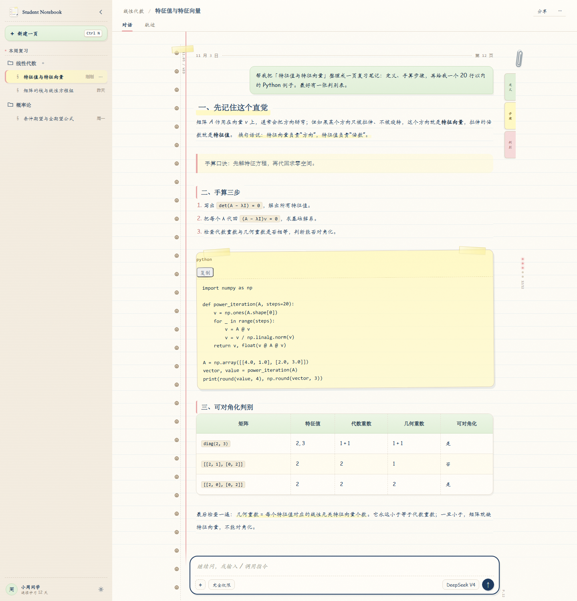

# Student-Notebook · 学生手账

> 一个给 DeepSeek Harness 的现代手账主题：暖米色纸张、32px 横线纸、红色边距线、纸边装订、页码/日期、索引贴、纸夹与阅读进度。



[](https://www.npmjs.com/package/dsh-student-notebook)
[](https://github.com/1583477320/dsh-student-notebook)
[](LICENSE)

主题是纯 CSS，不加载网络字体、不请求接口、不写入任何数据。它只做一件事：把 Harness 的阅读界面变成一本摊开的学生手账。

- npm：https://www.npmjs.com/package/dsh-student-notebook
- GitHub：https://github.com/1583477320/dsh-student-notebook

---

## 设计说明

### 纸张与墨色

| Token | Value | 用途 |
| --- | --- | --- |
| `--sn-paper` | `#FDFBF5` | 主纸张 / 聊天底色 |
| `--sn-kraft` | `#F4EDE1` | 侧边栏牛皮纸 |
| `--sn-ink` | `#1E3A5F` | 主墨色 / 标题 / 输入框描边 |
| `--sn-red` | `#E8A7A7` | 红色边距线 / 选中标记 |
| `--sn-yellow` | `#FFF9C4` | 荧光笔 / 胶带 |
| `--sn-mint` | `#E2F0D9` | 用户便签 / 新建按钮 |
| `--sn-line` | `#E5DDD0` | 纸张边缘 / 分割线 |

- 圆角统一在 `12px` 左右，输入框单独用 `20px`。
- 边框 `1px solid #E5DDD0`，阴影使用 `2px 3px 0 rgba(0,0,0,.04)` 的硬阴影，避免“软糖”质感。
- 全局字体：`"Comic Sans MS", "Kaiti SC", "STKaiti", "楷体", sans-serif`
- 标题/引用：`"Noto Serif SC", "Songti SC", serif`
- 小屏正文：`"Microsoft YaHei UI", "PingFang SC", "Noto Sans SC", system-ui, sans-serif`
- 代码：`"Fira Code", "Source Code Pro", monospace`

### 关键组件

**横线纸主聊天区**
- `[data-conversation-scroll]` 上叠加 `repeating-linear-gradient`，每 `32px` 一条 `rgba(135,175,215,.14)` 横线。
- 正文使用 `line-height: 32px` 的同一套网格；段落、列表、引用再各自带一层局部横线纸，避免全局横线落在半行上穿过文字。
- 红色边距线通过 `--sn-margin-x` 计算，始终落在居中阅读栏左侧约 25px：
  ```css
  --sn-margin-x: max(28px, calc(50% - var(--dsh-chat-content-width, 748px) / 2 - 25px));
  ```
- `background-attachment: scroll, local`：红色边距线固定在视口，横线随内容一起滚动。
- 小屏把网格降到 `28px`，并切换系统无衬线正文字体。

**纸边装订 / 页边组件**
- 侧边栏不再打孔，也去掉了右侧纸边；它只负责导航。
- 唯一装订线在正文纸左侧：虚线、孔位、纸色高光；红色页边线在它右侧。
- 页边栏由 `client.js` 注入到阅读列，包含：
  - **A** 日期、动态页码
  - **B** 右侧「定义 / 步骤 / 判别」索引贴
  - **C** 纸夹与和纸胶带
  - **E** 阅读进度圆点与 `P.1–P.12` 页码
- 页边栏固定在滚动视口内，滚动时页码和进度同步更新；宽度低于 `1120px` 时整体隐藏，避免挤压正文。

**荧光笔 `<mark>`**
- 只画下半部分：`background-size: 100% 40%; background-position: 0 100%;`
- 两端透明度略低，模拟马克笔起笔/收笔。
- `box-decoration-break: clone`，跨行时每行都有高亮。

**胶带便利贴代码块**
- `.md-code-block` 轻微旋转 `rotate(-0.5deg)`，悬停回正。
- 顶部左右各一条伪元素“和纸胶带”，半透明黄色，带纸边和硬阴影。
- 代码块本体使用半透明黄色纸张 + `3px 5px 0` 硬阴影。

**输入框**
- `2px` 主墨色描边、`20px` 圆角。
- `:focus-within` 时边框加深，并出现一圈淡黄色 focus halo。

---

## 安装

### 从本地目录安装（推荐）

```bash
dsh plugin --profile desktop add "D:\dsh插件\dsh-student-notebook"
# 或 Web profile
dsh plugin --profile web add "D:\dsh插件\dsh-student-notebook"
```

安装后重启对应的 `dsh` 会话：

```bash
dsh --profile desktop
# 或
dsh --profile web
```

确认已挂载：

```bash
dsh plugin --profile desktop list
```

卸载：

```bash
dsh plugin --profile desktop remove dsh-student-notebook
```

### 从 npm 安装

```bash
dsh plugin --profile desktop add dsh-student-notebook
# 或 Web profile
dsh plugin --profile web add dsh-student-notebook
```

然后重启对应的 `dsh` 会话。

### 只想要 CSS

`student-notebook.css` 是完整、可直接注入的样式：

1. 用编辑器打开 `student-notebook.css`，全选复制；
2. 打开 DevTools → Console，执行：
   ```js
   const style = document.createElement('style');
   style.textContent = `/* 把 student-notebook.css 的内容粘贴到这里 */`;
   document.body.appendChild(style);
   ```
   或直接把内容粘贴进页面末尾的 `<style>` 标签。
3. 不需要构建、不需要客户端插件。

> 建议把 `<style>` 放到 `body` 末尾，让它晚于 DSH 自带的主题样式加载。直接注入只影响当前页面；刷新后失效。长期使用请安装插件。

---

## 包结构

```text
dsh-student-notebook/
├─ package.json
├─ index.js                 # Host 侧空实现，仅用于挂载
├─ client.js                # 构建产物：内联 CSS 的客户端插件
├─ cordis.patch.yml         # 插入 dsh-student-notebook 行
├─ student-notebook.css     # 构建产物：可单独注入的完整 CSS
├─ src/
│  ├─ theme.css             # 源样式（改这里）
│  └─ client.template.js    # 客户端模板
├─ build.mjs                # node build.mjs
├─ locale/{zh,en}.json
├─ icon.svg
├─ preview.html             # 独立静态预览
├─ preview.css              # 预览页布局（不属于主题）
└─ preview.png
```

---

## 开发

```bash
cd "D:\dsh插件\dsh-student-notebook"
node build.mjs
```

`build.mjs` 会：

1. 读取 `src/theme.css`；
2. 生成 `student-notebook.css`；
3. 把 CSS 以 JSON 字符串注入 `src/client.template.js`，生成 `client.js`。

修改样式后重新运行即可；客户端插件使用 `ctx.effect` 注入 `<style data-plugin-css="dsh-student-notebook/student-notebook.css">`，卸载时会自动移除。

### 本地预览

直接用浏览器打开 `preview.html`。它使用与 Harness 相同的语义类名（`an3WzG_*`、`GRgSLq_*`、`md-code-block`、`wnFoaW_*`），可以在不启动 DSH 的情况下检查纸张、纸边装订、页边组件、胶带和输入框。

---

## 兼容性

Harness 的 CSS Module 类名带构建哈希，因此主题优先使用：

- 稳定的 `data-*` 属性：`[data-conversation-scroll]`、`[data-composer-seat]`、`[data-code-block-banner]`、`[data-chat-flow]`；
- 语义 class 后缀：`[class*="sidebarCol"]`、`[class*="GRgSLq_card"]`、`[class*="wnFoaW_sessionRow"]`；
- 少量当前版本的完整类名作为增强（如 `an3WzG_*`），即使哈希变化，基础样式仍然生效。

其他行为：

- **强制浅色**：即使 Harness 切到暗色模式，`body[data-ds-dark-theme]` 也会被主题的纸色覆盖，避免出现“黑纸白字”。
- **样式顺序**：`client.js` 把 `<style>` 放到 `body` 末尾，确保晚于 Harness 自带的主题样式加载，因此不依赖 `!important` 也能覆盖 token。
- **阅读网格**：正文、段落、列表共享 `--sn-reading-line`；段落自带局部横线纸，避免整页横线穿过字形。
- **页边组件**：`client.js` 把日期、页码、索引贴、纸夹、胶带和进度栏注入阅读列；位置随列宽/滚动更新，卸载时移除。
- **小屏字体**：`max-width: 720px` 时正文切换系统无衬线、15px、500 字重和 28px 网格。
- **不加载外部资源**：不引用 Google Fonts、不请求图片；字体使用系统回退。
- **减少动态**：`prefers-reduced-motion: reduce` 时关闭代码块倾斜和过渡。
- **高对比模式**：`forced-colors: active` 时为 `mark` 和代码块提供系统色回退。
- **焦点可见**：`:focus-visible` 使用 2px 主墨色轮廓。

---

## 自定义

所有设计变量都在 `src/theme.css` 顶部的 `:root` 中。常用改法：

```css
:root {
  --sn-paper: #FDFBF5;      /* 纸张 */
  --sn-kraft: #F4EDE1;      /* 侧边栏 */
  --sn-ink: #1E3A5F;        /* 主墨色 */
  --sn-rule-gap: 32px;      /* 横线间距 */
  --sn-reading-line: 32px;  /* 正文行高，要和横线间距一致 */
  --sn-rule-alpha: 0.14;    /* 横线透明度 */
}
```

- 想换字体：改 `--sn-font-ui`、`--sn-font-serif`、`--sn-font-sans`、`--sn-font-code`。
- 想调横线：`--sn-rule-gap` 和 `--sn-reading-line` 必须同时改（桌面 32px，小屏 28px）。
- 想减弱胶带：把 `.md-code-block::before/::after` 的 `opacity` 调到 `0.5`。
- 想禁用倾斜：删除 `.md-code-block` 的 `transform`，或在 `prefers-reduced-motion` 中已自动关闭。
- 想改边距线位置：调整 `--sn-margin-x` 里的 `25px` 偏移。

---

## Links

- npm：[dsh-student-notebook](https://www.npmjs.com/package/dsh-student-notebook)
- GitHub：[1583477320/dsh-student-notebook](https://github.com/1583477320/dsh-student-notebook)
- Issues：[提交问题或建议](https://github.com/1583477320/dsh-student-notebook/issues)

---

## License

MIT
